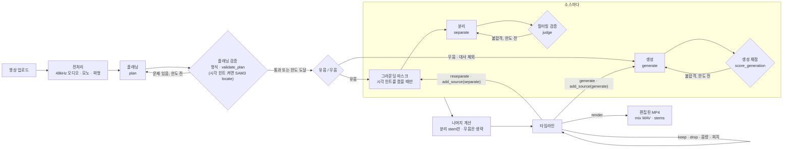
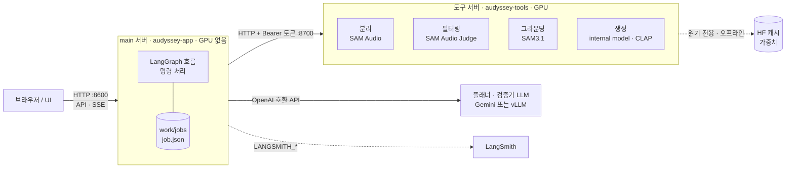

# Audyssey

짧은 영상(10초 안팎)의 오디오를 소리 나는 대상별 트랙으로 나눕니다.
유음 영상은 분리 뒤 원하는 효과음·음악·환경음을 생성으로 바꾸거나 추가할 수 있고, 무음 영상은 대사를 제외한 소스를 자동 생성합니다.
트랙을 들어 보고 켜고 끄거나 음량·피치를 바꾼 뒤 다시 합쳐, 편집된 영상과 트랙별 오디오(stems)를 내보냅니다.

**현재 단계: 뼈대(skeleton).** 실제 모델로 처음부터 끝까지 도는 것까지 확인했고, 품질은 아직 보지 않았습니다.
담당자별로 모듈을 교체해 나갑니다.

## 바로 해 보기 (GPU 없이)

```bash
uv sync --extra ui
uv run audyssey serve
# 브라우저에서 http://127.0.0.1:8600 을 열고 samples/sample.mp4 업로드
```

모든 모델 자리에 가짜(stub) 구현이 들어가 있어 GPU, API 키, 모델 다운로드가 필요 없습니다.
필요한 것은 Python 3.11 이상, [uv](https://docs.astral.sh/uv/), ffmpeg입니다.

## 구조





- **단계 순서는 코드에 고정**되어 있습니다(LangGraph). 업로드하면 타임라인까지 자동으로 진행하고, 그다음 편집은 사용자가 명령을 보내서 합니다.
- **플래닝과 분리 뒤에 검증**이 있고, 실패하면 정해진 횟수만큼 다시 합니다.
- **main 서버는 GPU를 쓰지 않습니다.** 모델은 도구 서버(SAM Audio, Judge, SAM3, 생성 internal model)와 플래너 LLM(Gemini 또는 vLLM)을 API로 부릅니다.
- **도구마다 `stub`(가짜), `real`(직접 실행), `remote`(다른 서버 호출)를 고를 수 있습니다.** 그래서 내 모듈만 실제 모델로 돌리고 나머지는 stub으로 둘 수 있습니다.
- **생성 real은 팀 내부 모델(internal model) + CLAP 채점입니다.** 분리·Judge·그라운딩과 같은 `gpu/` 환경과 `audyssey-tools` 이미지에 들어 있습니다. 대사는 생성하지 않고, 생성 stem은 residual 계산에 넣지 않습니다.
- **시각 힌트는 기본으로 꺼져 있습니다.** 분리는 텍스트 설명과 구간으로 합니다.

용어, 검증 규칙, 함수 시그니처, API, 코드 위치는 [docs/architecture.md](docs/architecture.md)에 있습니다.

## 실행 방법

**기능 수정과 실험은 stub으로 하고, A100 80GB급 GPU는 실제 모델 통합 테스트 때만 빌립니다.**
- stub은 GPU 없이 노트북에서 흐름 전체(업로드 → 플래닝 → 분리 → 검증 → 편집 → 합치기)를 1초 안에 돌립니다. 그래프, API, UI, 편집처럼 모델 품질과 상관없는 수정은 stub과 단위 테스트로 끝냅니다.
- 내 모듈만 실제 모델로 바꿔 볼 때도 나머지는 stub으로 둡니다. 플래너는 Gemini API로 GPU 없이 실제 호출할 수 있습니다.
- Compose는 6개 컨테이너(main, separation, judge, grounding, generation, vllm)입니다. 생성 포함 한 장 최대 메모리는 56.6GB였습니다(후보 4개, [실측](docs/status.md)). 전체 GPU 테스트 때만 GPU를 빌리고, 끝나면 바로 내리고 반납합니다.

| 상황 | 필요한 것 | 안내 |
|---|---|---|
| GPU 없이 흐름만 확인 | Python 3.11+, uv, ffmpeg | 위 "바로 해 보기" |
| **실제 모델로 전체 실행 (처음이면 여기부터)** | HF 승인, 팀 HF 조직 가입, 읽기 토큰 | [실제 모델로 실행하기](docs/running.md#실제-모델로-실행하기-팀원용) |
| ㄴ 내 GPU 서버에서 | Docker, NVIDIA Container Toolkit, GPU 1장(80GB면 한 장에 전부) | [A. 내 GPU 서버](docs/running.md#a-내-gpu-서버에서-docker-compose) |
| ㄴ 노트북 + RunPod | 노트북 Docker, RunPod Pod 1개(48GB 이상), 네트워크 볼륨 | [B. 노트북 + RunPod](docs/running.md#b-노트북--runpod) |
| 내 모듈만 GPU로 개발 | GPU, `gpu/` 환경 | [모듈 개발](docs/running.md#내-모듈만-gpu로-개발) |
| 플래너를 Gemini나 vLLM으로 | API 키 또는 vLLM 주소 | [플래너 연결](docs/running.md#플래너-연결-gemini-vllm) |
| 실행 기록 보기 | LangSmith 키 | [LangSmith](docs/running.md#langsmith) |

막히면 [자주 막히는 곳](docs/running.md#자주-막히는-곳)을, 모든 설정 값은 [설정 표](docs/running.md#설정-환경변수)를 봅니다.

## 작업 규칙

- **담당 모듈 폴더만 고칩니다.** `src/audyssey/tools/<모듈>/real.py`를 같은 시그니처로 구현하면 나머지 코드는 그대로 돕니다.
- **`contracts.py`(공통 계약)를 바꿀 때는 PR에서 팀 합의를 먼저 받습니다.**
- **main에는 PR로만 반영합니다.** CI(ruff, ty, 테스트)를 통과해야 머지할 수 있고, 머지하면 Docker 이미지가 GHCR에 자동으로 올라갑니다.
- **테스트를 먼저 쓰고, 검사를 우회하지 않습니다**(`noqa`, `ty: ignore`, skip 금지).
- **`.env`, 토큰, 가중치는 커밋하지 않습니다.**

브랜치·커밋 형식, 단계별 CI/CD 흐름, 로컬 검사 명령은 [docs/contributing.md](docs/contributing.md)에 있습니다.

## 모듈별 담당

| 모듈 | 위치 | 담당 | 할 일 |
|---|---|---|---|
| 오케스트레이터·API | `graph.py`, `api.py`, `store.py` | 오케스트레이터 담당 | 소스별 병렬 처리, 자연어 → 명령 번역 |
| UI | `devui/` (임시) | UI 담당 | API로 최종 화면 설계·구현 |
| 플래닝 | `tools/planning/real.py` | 플래닝 담당 | `plan`·`validate_plan` 교체, 모델 선택, 오디오 정보 반영 |
| 분리 | `tools/separation/real.py` | 분리 담당 | 재시도할 때 조건·후보 수를 바꾸는 전략 |
| 필터링 | `tools/filtering/real.py` | 필터링 담당 | 합격 기준 보정, 실패 이유와 `suggestion` 생성 |
| 그라운딩 | `tools/grounding/real.py` | 미정 | 위치 확인 강화, 추적 실패 대비 |
| 생성·채점 | `tools/generation/real.py` | 미정 | internal model 생성, CLAP TargetSel 보정 |
| 편집·합치기 | `tools/editing/render.py` | 미정 | 편집 품질, 편집 명령 추가 |
| 인프라·배포 | `docker/`, `compose.yaml`, `.github/workflows/` | 인프라 담당 | RunPod 템플릿 검증, 캐시 준비 안내 |

모듈별 남은 과제와 실측 기록은 [docs/status.md](docs/status.md)에 있습니다.

## 문서

| 문서 | 내용 |
|---|---|
| [docs/architecture.md](docs/architecture.md) | 서버 구성, 용어, 검증과 재시도, 계약·함수·명령·API, 코드 위치 |
| [docs/running.md](docs/running.md) | 상황별 실행 방법, 플래너 연결, LangSmith, 가중치 준비, 설정 표 |
| [docs/contributing.md](docs/contributing.md) | 코드 규칙, 브랜치와 커밋, CI/CD 단계, 로컬 검사 |
| [docs/status.md](docs/status.md) | 모듈별 남은 과제, 실측 기록 |
| [설계 원문](docs/superpowers/specs/2026-11-09-audyssey-skeleton-design.md) | 처음 합의한 설계와 결정 기록 |
