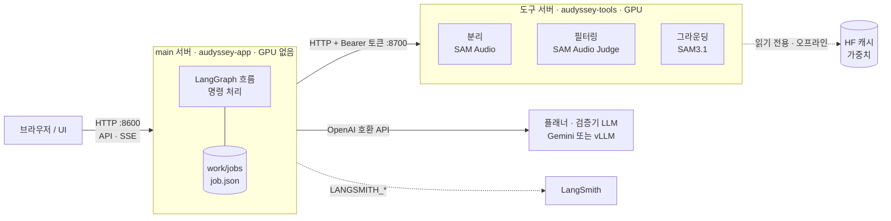
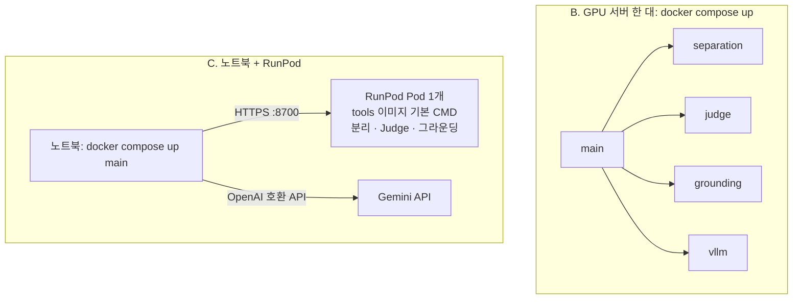

# Audyssey

짧은 영상(10초 안팎)의 오디오를 **소리를 내는 개체별 트랙**으로 나누고, 트랙을 듣고 남기거나 빼고
음량·피치를 바꾼 뒤 다시 합쳐 **편집된 영상과 멀티트랙 stems**를 내보내는 도구입니다.

지금은 **뼈대(skeleton) 단계**입니다. 모든 모듈이 실제 모델로 서버 사이 API를 통해 끝까지 도는 것을
확인했지만, 각 모듈의 품질은 아직 연결 확인 수준입니다. 각 담당자가 자기 모듈을 교체해 나갑니다.

- [1. 설계 요약](#1-설계-요약)
- [2. 실행 방법 (환경·경우별)](#2-실행-방법-환경경우별)
- [3. 팀 작업 규칙과 CI/CD](#3-팀-작업-규칙과-cicd)
- [4. 모듈별 담당 작업](#4-모듈별-담당-작업)
- [5. 모듈별 현재 미흡한 점](#5-모듈별-현재-미흡한-점)
- [6. 실측 기록](#6-실측-기록)

전체 설계 명세서: [docs/superpowers/specs/2026-11-09-audyssey-skeleton-design.md](docs/superpowers/specs/2026-11-09-audyssey-skeleton-design.md)

---

## 1. 설계 요약

### 1.1 처리 흐름


- 오케스트레이터는 **고정 흐름의 LangGraph**입니다. LLM이 다음 단계를 고르지 않습니다.
- 업로드하면 타임라인까지 멈추지 않고 진행하고, 그 뒤 사용자가 **명령**으로 편집합니다.
- 플래닝과 필터링에는 각각 **검증 루프**가 있습니다(1.4).

### 1.2 서버 구성



- **main 서버**는 흐름만 실행합니다. 모델은 모두 API로 부릅니다.
- **도구 서버**는 HTTP 창구가 없는 SAM 계열 모델을 감쌉니다. 도구마다 `stub`/`real`/`remote`를 고를 수 있습니다.
  - `stub`: GPU 없이 형식만 맞춘 가짜 결과
  - `real`: 같은 프로세스에서 모델 실행
  - `remote`: 다른 서버의 도구 서버를 HTTP로 호출
- **플래너·검증기 LLM**은 OpenAI 호환 주소만 바꾸면 Gemini와 직접 띄운 vLLM 사이를 오갈 수 있습니다.
- 이미지는 설치 환경별로 두 개입니다.
  - `audyssey-app`: main, Python 3.13
  - `audyssey-tools`: 도구 서버, CUDA 12.8, Python 3.12
- Compose는 도구마다 컨테이너를 따로 띄웁니다. RunPod에서는 tools 이미지 하나로 Pod 하나에서 세 도구를 함께 띄웁니다.



### 1.3 핵심 개념

| 개념 | 정의 |
|---|---|
| 소스 | 소리를 내는 개체 하나. 같은 개체가 여러 번 소리를 내면 소스 1개에 구간 여러 개. 다른 개체는 종류가 같아도 다른 소스 |
| 분리 조건 | 텍스트(필수), 구간 span(선택), 시각 힌트(선택: 시점·0~1 정규화 박스·설명) |
| 시각 힌트 | 플래너가 화면에 보이는 소스마다 자동 생성. **기본은 쓰지 않음** (`AUDYSSEY_VISUAL_PROMPT=false`, 분리는 텍스트·구간으로). 켜면 SAM3가 위치를 확인하고 대상 밖을 검게 칠한 마스크 영상을 만들어 분리에 사용 |
| 분리 트랙 | 소스당 1개, 원본과 길이가 같은 48kHz mono float32 WAV |
| 나머지(residual) | `원본 − Σ(소스 트랙)`. 아무것도 바꾸지 않고 합치면 원본과 같음. `source_id="residual"`로 keep/drop/gain 가능 |

### 1.4 검증 루프

| | 플래닝 검증 루프 | 필터링 검증 루프 |
|---|---|---|
| 검증 | 형식 검사(오케스트레이터) → `validate_plan` → (시각 힌트를 켰을 때) 힌트마다 SAM3 `locate` | `judge`가 분리 트랙을 평가 |
| 실패 시 | `PlanIssue` 목록을 `plan(feedback=…)`에 전달해 전체를 다시 계획 | `suggestion`이 있으면 그 조건으로, 없으면 `attempt`+1로 해당 소스만 재분리 |
| 한도 | `AUDYSSEY_MAX_PLAN_ROUNDS=2` | `AUDYSSEY_MAX_SEPARATION_RETRIES=2` (총 3회) |
| 한도 도달 | 마지막 계획으로 진행, 경고 표시 | 마지막 트랙 사용, `filter.passed=False` 경고 |

### 1.5 계약·도구 함수·명령·API

모든 모듈이 공유하는 데이터 형식은 [`src/audyssey/contracts.py`](src/audyssey/contracts.py)의 Pydantic 모델입니다.
주요 모델은 `SourcePlan`, `VisualHint`, `PlanIssue`, `FilterResult`, `GroundResult`, `Job`, `Command`입니다.
오디오는 파일 경로로 주고받고, 시간은 초 단위 float입니다.

도구 함수는 `stub`/`real`/`remote`가 모두 같은 시그니처입니다.

```python
plan(video_path, audio_path, duration, feedback: list[PlanIssue]) -> list[SourcePlan]
validate_plan(video_path, audio_path, plans: list[SourcePlan]) -> list[PlanIssue]  # 빈 목록 = 통과
separate(mono_path, plan: SourcePlan, masked_video_path | None, out_path, attempt: int) -> out_path  # None = 텍스트만
judge(mono_path, track_path, plan: SourcePlan) -> FilterResult
locate(video: Path, hint: VisualHint) -> GroundResult
mask_video(video: Path, hint: VisualHint, out: Path) -> Path
render(job: Job, job_dir, include_residual_stem: bool) -> RenderOutput
```

사용자 작업의 상태 변경은 **모두 명령**(`graph.handle_command`)으로 합니다. 버튼, 나중에 붙일 자연어 번역기,
에이전트가 같은 명령을 쓰기 위한 필수 원칙입니다.

```
keep / drop(source_id)            set_gain(source_id, 0.0~2.0)     set_pitch(source_id, -12~+12)
reseparate(source_id, description?, spans?)   add_source(plan)     render(include_residual_stem)
```

UI가 기대는 것은 아래 API뿐입니다.

```
POST /api/jobs                    multipart(video) → Job (업로드 + 자동 흐름 시작)
GET  /api/jobs                    → Job 요약 목록
GET  /api/jobs/{id}               → Job
GET  /api/jobs/{id}/events        SSE: 상태가 바뀔 때마다 Job 스냅샷
POST /api/jobs/{id}/commands      Command → Job | 409(실행 중) | 422(형식 오류)
GET  /api/jobs/{id}/files/{path}  작업 폴더의 오디오·영상·파형 파일
```

도구 서버 API는 다음과 같습니다.

```
GET  /health                                    인증 없음
POST /separate  multipart mono, plan, attempt (+ video)     → WAV   video는 시각 힌트를 켰을 때만
POST /judge     multipart mono, track, plan                  → FilterResult
POST /locate    multipart video, hint                        → GroundResult
POST /mask      multipart video, hint                        → MP4
```

`/health`를 뺀 요청에는 `Authorization: Bearer $AUDYSSEY_TOOL_TOKEN`이 필요합니다.

### 1.6 코드 구조

```
src/audyssey/
  contracts.py   팀 공통 계약 (변경은 PR로 합의)
  settings.py    AUDYSSEY_* 환경변수 (pydantic-settings)
  graph.py       LangGraph 흐름, 검증 루프, 명령 처리
  store.py       Job ↔ work/jobs/<id>/job.json
  api.py         HTTP API + 개발용 화면
  toolserver.py  도구 서버
  cli.py         audyssey serve | audyssey tool-server
  media.py       ffmpeg 추출·프레임·WAV 입출력
  devui/         빌드 없는 개발용 화면 (최종 UI 아님)
  tools/
    planning/    stub.py real.py llm.py      plan, validate_plan
    separation/  stub.py real.py remote.py   separate (SAM Audio)
    filtering/   stub.py real.py remote.py   judge (SAM Audio Judge)
    grounding/   stub.py real.py remote.py   locate, mask_video (SAM3)
    editing/     render.py                   residual, pitch, render
gpu/             GPU 도구 전용 uv 프로젝트 (Python 3.12, numpy 1.26, torch cu128)
docker/          app.Dockerfile, tools.Dockerfile
compose.yaml     main + separation + judge + grounding + vllm
tests/           unittest (GPU 코드는 가짜 torch/sam_audio로 검사)
```

---

## 2. 실행 방법 (환경·경우별)

| 경우 | 필요한 것 | 바로 가기 |
|---|---|---|
| A. GPU 없이 흐름만 확인 | Python 3.11+, uv, ffmpeg | [2.1](#21-a-gpu-없이-노트북에서-stub) |
| B. GPU 서버 한 대에서 전부 | Docker, NVIDIA Container Toolkit, 가중치 캐시 | [2.2](#22-b-gpu-서버-한-대에서-전부-docker-compose) |
| C. 노트북 + 대여 GPU(RunPod) | 노트북 Docker, RunPod Pod 1개 | [2.3](#23-c-노트북--runpod-gpu) |
| D. 내 모듈만 GPU로 개발 | GPU, `gpu/` 환경 | [2.4](#24-d-내-모듈만-gpu로-개발) |
| 플래너를 Gemini/vLLM으로 | API 키 또는 vLLM | [2.5](#25-플래너를-gemini-또는-vllm으로) |
| LangSmith로 보기 | LangSmith 키 | [2.6](#26-langsmith-모니터링) |

### 2.1 A. GPU 없이 노트북에서 (stub)

```bash
uv sync --extra ui
uv run audyssey serve
# http://127.0.0.1:8600 에서 samples/sample.mp4 업로드
```

모든 도구가 stub이며 두 검증 루프가 한 번씩 돕니다. 개발용 화면에서 재생, keep/drop, 음량, 피치,
설명 수정 후 재분리, 소스 추가, 합치기를 해 볼 수 있습니다. 편집 없이 합친 WAV는 원본과 수치 오차 범위에서 같습니다.

### 2.2 B. GPU 서버 한 대에서 전부 (Docker Compose)

```bash
cp .env.example .env      # .env는 커밋하지 않음
# .env에서 AUDYSSEY_TOOL_TOKEN을 긴 임의 값으로, HF_CACHE를 가중치 캐시 경로로 바꿈
docker compose pull       # 또는 직접 빌드: docker compose build
docker compose up
# http://localhost:8600 (원격 서버라면 SSH 터널: ssh -L 8600:localhost:8600 <서버>)
```

- main, separation, judge, grounding, vllm 다섯 컨테이너가 뜹니다. 호스트에는 main의 `127.0.0.1:8600`만 공개합니다.
- main(app 서버)에는 인증이 없습니다. `127.0.0.1` 밖으로 열지 말고, 원격에서 볼 때는 SSH 터널을 쓰세요. 외부에 열어야 하면 인증이 있는 리버스 프록시를 앞에 두어야 합니다.
- GPU는 도구마다 `AUDYSSEY_SEPARATION_GPU`, `AUDYSSEY_JUDGE_GPU`, `AUDYSSEY_GROUNDING_GPU`, `AUDYSSEY_VLLM_GPU`로 지정합니다.
  - 모두 같은 번호면 GPU 한 장을 나눠 씁니다.
  - `.env.example`은 GPU 0 한 장을 나눠 쓰는 설정이며 vLLM 메모리 비율 `AUDYSSEY_VLLM_GPU_UTIL=0.2`입니다(80GB A100에서 확인).
  - vLLM에 GPU를 따로 주면 이 값을 `0.85` 정도로 올립니다.
- 가중치 캐시(`HF_CACHE`)는 컨테이너에 `/hf`로 읽기 전용 연결되며 오프라인(`HF_HUB_OFFLINE=1`)으로 읽습니다.
- 작업은 `jobs` 볼륨에 남습니다.
- 컨테이너는 root가 아닌 uid 10001로 실행합니다. 예전 root 이미지로 만든 볼륨은 쓰기 권한이 없으니 `docker volume rm audyssey_jobs` 후 다시 띄웁니다.
- sv3-a100 예: `HF_CACHE=/home/common/huggingface`.
  - 기본 Docker 빌드 엔진이 서버 설정 문제로 실패하므로 `docker buildx --builder <docker-container 빌더>`로 빌드합니다.
- 플래너 기본값은 내부 vLLM(`Qwen/Qwen2.5-VL-3B-Instruct`)입니다. Gemini를 쓰면 vLLM 없이 `docker compose up main separation judge grounding`으로 띄웁니다.
- GPU 없이 Compose main만: `AUDYSSEY_PLANNER=stub`과 도구 stub 또는 원격 주소를 설정하고 `docker compose up main`을 실행합니다.

### 2.3 C. 노트북 + RunPod GPU

RunPod에서는 Pod 안에서 Docker Compose를 쓸 수 없습니다. 그래서 tools 이미지 하나의 기본 CMD로 세 도구를 한 프로세스에서 띄우고,
노트북에서는 main만 띄웁니다.

| RunPod 설정 | 값 |
|---|---|
| Container image | `ghcr.io/capstone-audissey-fall-2026/audyssey-tools:latest` (공개 이미지) |
| GPU | 1장, CUDA 12.8 드라이버. 세 도구 합계 추정 약 46GB(후보 1개)~53GB(후보 4개)이므로 80GB 권장. 48GB는 미확인 |
| Expose HTTP ports | `8700` |
| Container start command | 비움 (이미지 기본 CMD가 분리·Judge·그라운딩을 함께 실행) |
| Network volume | 가중치 캐시를 미리 받아 둔 볼륨을 `/workspace`에 연결 |
| 환경변수 | `HF_HOME=/workspace/huggingface`, `HF_HUB_OFFLINE=1`, `CUDA_VISIBLE_DEVICES=0`, 모델 ID 3개(2.7) |
| 비밀값 | `AUDYSSEY_TOOL_TOKEN`은 공유 템플릿에 넣지 말고 RunPod secrets로 주입 |

템플릿은 Templates → New Template에 저장하고 Pod 배포 시 고릅니다([공식 안내](https://docs.runpod.io/pods/templates/manage-templates)).
노트북 `.env`에는 같은 토큰과 Pod 주소를 넣습니다.

```dotenv
AUDYSSEY_TOOL_TOKEN=<Pod와 같은 토큰>
AUDYSSEY_SEPARATOR_URL=https://YOUR-POD-ID-8700.proxy.runpod.net
AUDYSSEY_FILTER_URL=https://YOUR-POD-ID-8700.proxy.runpod.net
AUDYSSEY_GROUNDING_URL=https://YOUR-POD-ID-8700.proxy.runpod.net
# 플래너는 Gemini 권장 (2.5)
AUDYSSEY_PLANNER_BASE_URL=https://generativelanguage.googleapis.com/v1beta/openai/
AUDYSSEY_PLANNER_MODEL=gemini-2.5-flash
GOOGLE_API_KEY=<비공개>
```

```bash
docker compose up main
# http://localhost:8600
```

### 2.4 D. 내 모듈만 GPU로 개발

SAM Audio의 numpy<2 제약 때문에 GPU 도구는 루트와 다른 uv 프로젝트 `gpu/`를 씁니다. 루트 환경과 CI에는 torch가 없습니다.

```bash
uv sync --project gpu --locked
# torchcodec(cu128)가 쓰는 NVIDIA NPP 라이브러리 경로 (Docker 이미지는 설정되어 있음)
export LD_LIBRARY_PATH="$PWD/gpu/.venv/lib/python3.12/site-packages/nvidia/npp/lib:${LD_LIBRARY_PATH:-}"
export HF_HOME=<가중치 캐시> HF_HUB_OFFLINE=1 CUDA_VISIBLE_DEVICES=0
export AUDYSSEY_TOOL_TOKEN=<임의 토큰>

# 내 도구만 real로 띄우기 (--tool은 separation | filtering | grounding, 여러 번 가능)
uv run --project gpu --locked audyssey tool-server --tool separation --impl real --host 127.0.0.1 --port 8700

# 다른 터미널: main은 루트 환경, 내 도구만 remote, 나머지는 stub
AUDYSSEY_SEPARATOR=remote AUDYSSEY_SEPARATOR_URL=http://127.0.0.1:8700 uv run audyssey serve
```

- 다른 모듈을 GPU에 올리지 않아도 됩니다. 나머지는 stub으로 둡니다.
- GPU 없이 HTTP 연결만 확인하려면 루트 환경에서 `--impl stub`으로 띄웁니다.
- 공개 주소(loopback 밖)에 바인딩하려면 토큰이 필수이고, TLS 프록시나 SSH 터널로 보호합니다.
- `/health`는 `{"tools": [...], "impl": "..."}`를 반환합니다.

분리·Judge 단독 확인(로딩·실행 시간, 최대 GPU 메모리, 판정, 결과 WAV를 JSON으로 출력):

```bash
uv run --project gpu --locked python scripts/sam_audio_smoke.py samples/sample.mp4 --description "a person speaking" --out work/jobs/smoke-text
uv run --project gpu --locked python scripts/sam_audio_smoke.py samples/sample.mp4 --description "a person speaking" --span 0 3 --out work/jobs/smoke-span
```

### 2.5 플래너를 Gemini 또는 vLLM으로

플래너 real(`planning/real.py`)은 영상 길이에 고르게 뽑은 JPEG 프레임(기본 4장)과 피드백을
OpenAI 호환 API로 보냅니다. 오디오는 아직 보내지 않습니다.

| 대상 | 설정 |
|---|---|
| Gemini | `AUDYSSEY_PLANNER=real`, `AUDYSSEY_PLANNER_BASE_URL=https://generativelanguage.googleapis.com/v1beta/openai/`, `AUDYSSEY_PLANNER_MODEL=gemini-2.5-flash`, 키는 `AUDYSSEY_PLANNER_API_KEY`(Compose는 `GOOGLE_API_KEY`를 대신 전달) |
| 직접 띄운 vLLM | `AUDYSSEY_PLANNER_BASE_URL=http://<vllm>:8000/v1`, `AUDYSSEY_PLANNER_MODEL=<모델 ID>`, 인증 없는 서버는 키 생략 |
| Compose 내부 vLLM | 기본값. `vllm/vllm-openai:v0.32.0` + `Qwen/Qwen2.5-VL-3B-Instruct` (캐시 필요) |

Python 직접 실행(`uv run audyssey serve`)은 `.env`를 읽지 않습니다. 환경변수로 주거나 `uv run --env-file .env ...`를 씁니다.

<details>
<summary>플래너만 실제로 한 번 호출해 보기</summary>

`plan`과 `validate_plan`을 한 번씩 호출해 소스 수, 이슈 수, 소요 시간만 출력합니다. 키와 응답 원문은 출력하지 않습니다.

```bash
cat > /tmp/audyssey-planner-live.py <<'PYTHON'
import json, os, time
from pathlib import Path
from tempfile import TemporaryDirectory
from audyssey.media import extract_audio, probe
from audyssey.tools.planning.real import plan, validate_plan

os.environ["LANGSMITH_TRACING"] = "false"
if os.environ.get("AUDYSSEY_PLANNER_BASE_URL", "").startswith("https://generativelanguage.googleapis.com/"):
    os.environ["AUDYSSEY_PLANNER_API_KEY"] = os.environ.get("AUDYSSEY_PLANNER_API_KEY") or os.environ["GOOGLE_API_KEY"]
video = Path(os.environ.get("AUDYSSEY_SMOKE_VIDEO", "samples/sample.mp4"))
with TemporaryDirectory() as tmp:
    audio = extract_audio(video, Path(tmp) / "audio.wav", False)
    duration, _ = probe(video)
    start = time.monotonic(); plans = plan(video, audio, duration, []); plan_s = time.monotonic() - start
    start = time.monotonic(); issues = validate_plan(video, audio, plans)
    print(json.dumps({"sources": len(plans), "issues": len(issues), "plan_s": plan_s, "validate_s": time.monotonic() - start}))
PYTHON

# Gemini
AUDYSSEY_PLANNER_BASE_URL=https://generativelanguage.googleapis.com/v1beta/openai/ \
AUDYSSEY_PLANNER_MODEL=gemini-2.5-flash \
uv run --env-file .env python /tmp/audyssey-planner-live.py

# Compose 내부 vLLM
docker compose up -d vllm   # 로그에 API 서버 준비 메시지가 뜰 때까지 대기
docker compose run --rm -T --entrypoint python \
  -e AUDYSSEY_PLANNER_BASE_URL=http://vllm:8000/v1 -e AUDYSSEY_PLANNER_MODEL=Qwen/Qwen2.5-VL-3B-Instruct \
  -e AUDYSSEY_PLANNER_API_KEY=unused -e AUDYSSEY_SMOKE_VIDEO=/samples/sample.mp4 \
  -v "$PWD/samples:/samples:ro" main - < /tmp/audyssey-planner-live.py
```

</details>

### 2.6 LangSmith 모니터링

`.env`(Compose) 또는 환경변수에 세 값을 넣으면 그래프, 도구 호출, 명령, LLM 토큰 사용량이 기록됩니다.

```dotenv
LANGSMITH_TRACING=true
LANGSMITH_API_KEY=<개인 키>
LANGSMITH_PROJECT=audyssey
```

- 웹 [smith.langchain.com](https://smith.langchain.com)의 Tracing에서 `audyssey` 프로젝트를 엽니다. 프로젝트는 첫 기록 때 자동으로 생깁니다.
- 기본은 꺼져 있습니다. 끌 때는 `LANGSMITH_TRACING=false`로 둡니다.
- 오디오·영상·프레임 바이트와 키·토큰은 올리지 않고 경로와 메타데이터만 남깁니다.
- 플래너 LLM 기록에는 모델명과 토큰 사용량만 남고, 이미지가 든 프롬프트와 응답 원문은 남지 않습니다.

### 2.7 가중치 준비

가중치는 레포와 이미지에 넣지 않습니다. 어떤 모델을 쓸지는 이미지가 아니라 환경변수(`.env` 또는 RunPod 템플릿)의
모델 ID로 정하고, 서버는 다운로드하지 않고 `HF_HOME` 캐시만 오프라인으로 읽습니다. 그래서 캐시는 미리 받아 둡니다.

**공식 모델을 씁니다.** 각자 Hugging Face에서 아래 공식 모델 페이지의 접근 승인(SAM License)을 받고,
자기 토큰으로 캐시에 받습니다. `.env.example`의 모델 ID도 공식 ID입니다.

```bash
# 승인 받은 계정으로 로그인 (토큰은 커밋·공유하지 않음)
uvx --from 'huggingface_hub[cli]<1.0' huggingface-cli login
export HF_HOME=<가중치 캐시>   # RunPod: /workspace/huggingface (네트워크 볼륨)
H="uvx --from huggingface_hub[cli]<1.0 huggingface-cli download"
$H facebook/sam-audio-large-tv
$H t5-base                                                   # SAM Audio 텍스트 인코더
$H facebook/sam-audio-judge --revision sam_audio
$H facebook/sam-audio-judge --include "*.json"               # Judge 토크나이저는 main에서 읽음
$H facebook/sam3.1 config.json sam3.1_multiplex.pt
# 후보 2개 이상(AUDYSSEY_SAM_AUDIO_RERANKING_CANDIDATES>1)일 때만
$H lukewys/laion_clap 630k-best.pt
$H roberta-base; $H bert-base-uncased; $H facebook/bart-base
# Compose 내부 vLLM 플래너를 쓸 때만
$H Qwen/Qwen2.5-VL-3B-Instruct
```

| 모델 | 설정 | 캐시에 필요한 것 |
|---|---|---|
| 분리 | `AUDYSSEY_SAM_AUDIO_MODEL` | `facebook/sam-audio-large-tv`, `t5-base` |
| 필터링 | `AUDYSSEY_SAM_AUDIO_JUDGE_MODEL` | `facebook/sam-audio-judge`의 `sam_audio` revision 전체와 `main` revision의 JSON(설정·토크나이저, 약 2MB) |
| 그라운딩 | `AUDYSSEY_SAM3_MODEL` | `facebook/sam3.1`의 `config.json`, `sam3.1_multiplex.pt` |
| 후보 고르기(선택) | 후보 2개 이상 | `lukewys/laion_clap`의 `630k-best.pt`, `roberta-base`·`bert-base-uncased`·`facebook/bart-base` |
| 플래너(선택) | `AUDYSSEY_VLLM_MODEL` | `Qwen/Qwen2.5-VL-3B-Instruct` |

- 승인을 기다리는 동안에는 비공식 미러 `mrfakename/sam-audio-large-tv`, `mrfakename/sam-audio-judge`를 모델 ID로 쓸 수 있습니다.
  - 미러도 사용 권한을 확인해야 합니다.
  - 미러 Judge는 `sam_audio` 브랜치의 `checkpoint.pt`가 캐시에 있어야 합니다.
- sv3-a100 공용 캐시 `/home/common/huggingface`에는 위 공식 모델과 미러가 모두 있습니다. 가중치를 복사하지 말고 이 경로를 그대로 연결합니다.

### 2.8 설정 (환경변수)

설정은 `AUDYSSEY_*` 환경변수로만 읽습니다(`src/audyssey/settings.py`).

| 환경변수 | 기본값 | 의미 |
|---|---|---|
| `AUDYSSEY_PLANNER` | `stub` | `stub` 또는 `real` (Compose 기본 `real`) |
| `AUDYSSEY_SEPARATOR` / `AUDYSSEY_FILTER` / `AUDYSSEY_GROUNDER` | `stub` | `stub`, `real`, `remote` (Compose 기본 `remote`) |
| `AUDYSSEY_SEPARATOR_URL` / `AUDYSSEY_FILTER_URL` / `AUDYSSEY_GROUNDING_URL` | 빈 값 | remote 도구 서버 주소. remote인데 비어 있으면 시작 시 오류 |
| `AUDYSSEY_TOOL_TOKEN` | 빈 값 | 도구 서버 Bearer 토큰 (main과 도구 서버에 같은 값) |
| `AUDYSSEY_REMOTE_TIMEOUT_S` | `600` | 원격 도구 호출 타임아웃(초) |
| `AUDYSSEY_PLANNER_BASE_URL` / `AUDYSSEY_PLANNER_MODEL` / `AUDYSSEY_PLANNER_API_KEY` | 빈 값 | OpenAI 호환 플래너 주소·모델·키 |
| `AUDYSSEY_PLANNER_FRAMES` | `4` | 플래너·검증기에 보내는 프레임 수 (1~16) |
| `AUDYSSEY_MAX_PLAN_ROUNDS` | `2` | 플래닝 최대 회차 |
| `AUDYSSEY_MAX_SEPARATION_RETRIES` | `2` | 소스당 재분리 횟수 (총 시도 = 1 + 이 값) |
| `AUDYSSEY_MAX_DURATION_S` | `30` | 업로드 영상 길이 상한 |
| `AUDYSSEY_MAX_UPLOAD_MB` | `200` | 업로드 파일 하나의 크기 상한 (app 서버와 도구 서버). 넘으면 413 |
| `AUDYSSEY_WORK_DIR` | `work/jobs` | 작업 폴더 |
| `AUDYSSEY_SAM_AUDIO_MODEL` | `facebook/sam-audio-large-tv` | 분리 모델 |
| `AUDYSSEY_SAM_AUDIO_JUDGE_MODEL` | `facebook/sam-audio-judge` | Judge 모델 (필터링과 후보 고르기에 사용) |
| `AUDYSSEY_SAM_AUDIO_DEVICE` | `cuda` | 분리·Judge 장치 |
| `AUDYSSEY_SAM_AUDIO_RERANKING_CANDIDATES` | `1` | 분리 후보 수. 2 이상이면 후보를 여러 개 만들고 CLAP×5 + Judge×1 앙상블로 하나를 고름 |
| `AUDYSSEY_SAM_AUDIO_CLAP_CHECKPOINT` | 빈 값 | 후보 고르기용 CLAP 파일. 빈 값이면 캐시의 `lukewys/laion_clap` 630k-best |
| `AUDYSSEY_SAM_AUDIO_IMAGEBIND_CHECKPOINT` | 빈 값 | 시각 힌트 소스의 후보 고르기용 ImageBind 파일. 빈 값이면 끔. Compose에서는 파일을 separation 컨테이너에 따로 마운트해야 함 |
| `AUDYSSEY_SAM_AUDIO_PREDICT_SPANS` | `false` | span이 없을 때 모델이 구간을 예측 (span predictor를 GPU에 추가로 올림) |
| `AUDYSSEY_JUDGE_PASS_THRESHOLD` | `0.5` | Judge overall 합격 기준 (미보정) |
| `AUDYSSEY_VISUAL_PROMPT` | `false` | 시각 힌트 사용. 켜면 계획 검증에서 SAM3 `locate`, 분리 전 `mask_video`를 실행하고 마스크 영상을 분리에 넣음 |
| `AUDYSSEY_SAM3_MODEL` / `AUDYSSEY_SAM3_DEVICE` | `facebook/sam3.1` / `cuda` | 그라운딩 모델·장치 (CUDA 전용) |
| `AUDYSSEY_SAM3_TRACK_FPS` | `2` | 마스크 추적 fps. `0`이면 원본 fps (24GB GPU에서 메모리 부족 위험) |

Compose 전용 값(`.env`): `HF_CACHE`, `AUDYSSEY_{SEPARATION,JUDGE,GROUNDING,VLLM}_GPU`, `AUDYSSEY_VLLM_MODEL`,
`AUDYSSEY_VLLM_GPU_UTIL`, `GOOGLE_API_KEY`, `LANGSMITH_*`.

---

## 3. 팀 작업 규칙과 CI/CD

### 3.1 코드 수정 규칙

- **자기 모듈 폴더만 고칩니다.**
  - 담당 도구는 `src/audyssey/tools/<모듈>/real.py`의 함수를 같은 시그니처(1.5)로 구현합니다.
  - 도구를 바꿀 때 `graph.py`, `api.py`, UI를 고칠 필요가 없어야 합니다. 고쳐야 한다면 설계 문제이니 팀에 공유합니다.
- **`contracts.py` 변경은 PR에서 팀 합의 후** 머지합니다. 모든 모듈이 이 파일에 기대기 때문입니다.
- **상태 변경은 명령으로만** 합니다(`handle_command`). 새 편집 기능은 새 명령으로 추가합니다.
- **설정은 환경변수로 받습니다.** 새 설정은 `settings.py`에 필드를 추가하고, 이 README 2.8 표에 한 줄, 테스트 하나를 함께 넣습니다.
  - 서버 고유 경로, 키, 모델 경로를 코드에 하드코딩하지 않습니다.
- **테스트 먼저 씁니다.** 기능 테스트 → 구현 → 통과 순서입니다.
  - CI에는 GPU가 없으므로 GPU 코드는 가짜 모듈로 검사합니다. 예: `tests/sam_audio_fakes.py`.
- **검사를 우회하지 않습니다.** `# noqa`, `ty: ignore`, 테스트 skip, 약해진 assert로 CI를 통과시키지 않고 코드를 고칩니다.
- **의존성**
  - 루트(`pyproject.toml`)에는 torch를 넣지 않습니다.
  - GPU 의존성은 `gpu/pyproject.toml`에 넣고 `uv lock --project gpu`로 잠급니다. 남의 패키지 버전 제약을 덮어쓰지 않습니다.
- **비밀값·가중치**
  - `.env`는 git에서 제외되어 있으니 커밋하거나 로그에 출력하지 않습니다.
  - 가중치는 HF 캐시에만 둡니다.
- **공용 서버**(sv3-a100 등)에서는 다른 사람이 쓰는 GPU, Docker 이미지, 캐시를 건드리지 않습니다.
  - 내가 만든 이미지·볼륨만 지웁니다.
  - 쓸 GPU 번호는 미리 공유합니다.

### 3.2 브랜치·커밋 컨벤션

- 브랜치: `<type>/<짧은-설명>`, 예: `feat/sam3-grounding`, `fix/tools-image-ffmpeg`, `docs/e2e-results`.
- 커밋: Conventional Commits 형식 `<type>(<scope>): <소문자 명령형 요약>`, 예:
  - `feat(separation): support reranking with configurable ranker checkpoints`
  - `fix(grounding): track masks at a reduced frame rate`
  - `build(docker): run app, tools and vllm containers as non-root`
  - `docs(readme): add sam3 grounding guide`
- type: `feat`, `fix`, `docs`, `build`(Docker·의존성), `test`, `refactor`, `chore`.
- scope: `planning`, `separation`, `filtering`, `grounding`, `graph`, `api`, `contracts`, `media`, `toolserver`, `docker`, `gpu`, `readme`, `spec` 등.
- 한 커밋에는 한 가지 변경만 담습니다. 테스트와 구현은 같은 커밋에 넣어도 됩니다.

### 3.3 commit → push → PR → merge → 배포

| 단계 | 자동으로 일어나는 일 | 내가 할 일 |
|---|---|---|
| 1. 브랜치 | 없음 | 최신 `main`에서 브랜치를 만듭니다 |
| 2. 커밋 | 없음 (로컬 훅 없음) | 커밋 전에 로컬 검사(3.4)를 통과시킵니다 |
| 3. push | 없음. 브랜치 push만으로는 CI가 돌지 않습니다 | `git push -u origin <브랜치>` |
| 4. PR (base: `main`) | `ci-lint` 워크플로가 두 job을 실행합니다. `lint-and-format-check`(필수): ruff lint·format, ty, unittest. `numpy-1x`: Python 3.12 + numpy 1.26 unittest | 설명에 요약과 확인 방법을 적습니다. `contracts.py`를 바꿨다면 팀 합의를 받습니다. 실패하면 코드를 고쳐 다시 push합니다 |
| 5. merge | `main` 보호 규칙이 적용됩니다: 필수 검사 통과 전 머지 불가, 관리자 포함 적용, 강제 push·브랜치 삭제 금지 | 필수 승인 수는 0이지만 리뷰를 받고 머지합니다. 머지 커밋 방식을 쓰며, 머지한 브랜치는 직접 지웁니다 |
| 6. 배포 | `main` 반영 시 `publish-images` 워크플로가 `audyssey-app`, `audyssey-tools`를 빌드해 GHCR에 `latest`와 커밋 SHA 태그로 올립니다(수동 실행도 가능, PR에서는 안 올림) | GPU 서버: `docker compose pull && docker compose up -d`. RunPod: 새 이미지를 받도록 Pod를 다시 배포하거나 SHA 태그로 고정합니다 |

이미지는 공개(public)라 로그인 없이 받을 수 있습니다. tools 이미지는 약 23GB라 빌드와 pull에 시간이 걸립니다.

### 3.4 로컬에서 CI와 같은 검사

```bash
uv sync --dev --locked --extra ui --extra llm
uv run ruff check src/
uv run ruff format --check src/
uv run ty check --error-on-warning src/
uv run python -m unittest discover tests
# numpy-1x job과 같은 검사
uv run --isolated --no-project --python 3.12 --with-editable '.[ui,llm]' --with 'numpy==1.26.4' python -m unittest discover tests
```

ffmpeg/ffprobe가 PATH에 있어야 테스트가 돕니다. 비밀값 없이 Compose 파일만 검사하려면 다음을 실행합니다.

```bash
env -i PATH="$PATH" docker compose --env-file .env.example config --no-env-resolution --quiet
```

---

## 4. 모듈별 담당 작업

| 모듈 | 위치 | 담당 | 지금 상태 | 해야 할 일 |
|---|---|---|---|---|
| 오케스트레이터·API | `graph.py`, `api.py`, `store.py` | 오케스트레이터 담당 | 고정 흐름, 검증 루프, 명령, SSE 동작 | 소스별 병렬 처리, 자연어 → 명령 번역 노드 |
| UI | `devui/` (임시) | UI 담당 | 개발용 화면만 있음 | 1.5 API만 사용해 최종 화면 설계·구현 |
| 플래닝 | `tools/planning/real.py` | 플래닝 담당 | LLM 연결 확인용 기본형 | `plan`·`validate_plan` 교체, 모델 선택, 오디오 정보 반영, 시각 힌트 검증 기준 |
| 분리 | `tools/separation/real.py` | 분리 담당 | SAM Audio large-tv, 후보 여러 개 지원 | 재시도마다 조건·후보 수 전략, 시각 조건 품질 확인 |
| 필터링 | `tools/filtering/real.py` | 필터링 담당 | SAM Audio Judge 예시 | 합격 기준 보정, 실패 이유와 `suggestion` 생성 |
| 그라운딩 | `tools/grounding/real.py` | 미정 | SAM3.1 위치 확인·마스크 | 위치 확인 강화, 추적 실패 대비 |
| 편집·합치기 | `tools/editing/render.py` | 미정 | DSP로 gain·pitch·render | 편집 품질, 추가 편집 명령 |
| 인프라·배포 | `docker/`, `compose.yaml`, `.github/workflows/` | 인프라 담당 | 이미지 2개, Compose, GHCR 자동 배포 | RunPod 템플릿 검증, 캐시 준비 안내 |

---

## 5. 모듈별 현재 미흡한 점

성능 문제가 아니라 뼈대 단계에서 확인된 한계입니다. 자세한 실측은 [설계 문서 §13](docs/superpowers/specs/2026-11-09-audyssey-skeleton-design.md#13-미결정--확인-필요)에 있습니다.

**오케스트레이터·API**
- 소스를 하나씩 차례로 분리합니다(`graph.py`의 `ponytail:` 표시). GPU 도구가 여러 개면 병렬화 여지가 있습니다.
- 서버 프로세스 하나, 작업 큐·DB·사용자 인증이 없습니다. SSE는 저장소를 주기적으로 읽습니다.
- 자연어 편집 입력(명령 번역 노드)은 아직 없습니다.

**UI**
- 개발용 최소 화면뿐이고 최종 UI는 정해지지 않았습니다.

**플래닝**
- 프레임 이미지만 보고 소스를 추정합니다. 오디오·전사를 쓰지 않아 실제로 들리는 소리인지 보장하지 못합니다.
- 기본 vLLM 모델(Qwen2.5-VL-3B)은 품질이 낮습니다. 예: 2라운드 뒤 소스가 1개만 남음.
- 검증기는 의심 소스만 보고하는 수준이고, 형식 오류가 두 번 나면 이슈 없이 진행합니다.

**분리**
- 재시도는 `attempt`를 시드로만 씁니다. 필터링이 `suggestion`을 주지 않으니 실제로는 같은 조건으로 다시 뽑습니다.
- 후보 고르기는 기본으로 꺼져 있습니다(후보 1개). ImageBind는 Compose에 마운트하지 않았습니다.
- 도구 서버당 모델 하나, 요청 하나씩만 처리합니다. 첫 호출에 모델을 로드하므로 첫 요청이 느립니다.

**필터링**
- 합격 기준 0.5는 보정 전입니다.
  - Judge overall은 1~5 범위로 보입니다.
  - 대사·효과음은 약 1.0, 앰비언스는 약 3.2처럼 소스 종류에 따라 크게 다릅니다.
  - 지금 기준으로는 거의 모두 통과합니다.
- 실패 이유와 수정 조건(`suggestion`)을 만들지 않습니다.

**그라운딩**
- 힌트 박스를 함께 주므로 SAM3가 박스 안에서 거의 항상 무언가를 찾습니다. 없는 대상도 found가 되어 검증으로서 약합니다.
- 시각 힌트는 기본으로 꺼져 있습니다. 텍스트 설명이 있으면 마스크가 분리 결과를 거의 바꾸지 못했습니다(실측 기록 참고). 같은 성별 두 사람처럼 텍스트로 구분이 안 되는 장면에서만 켤 만합니다.
- 마스크는 대상만 남기고 나머지를 검게 칠합니다. SAM Audio의 `mask_videos`는 반대로 대상을 지우지만, 공식 벤치마크 화자 쌍에서 마스크가 효과를 낸 경우는 모두 우리 방향이었습니다. 코드를 `mask_videos`에 맞춰 바꾸지 마세요.
- 아주 작은 대상을 추적 중에 놓치면 마스크 전체가 실패합니다(`No points are provided`). 해당 소스만 실패합니다.
- 메모리 때문에 2fps로 추적합니다. CUDA 전용입니다.

**편집·합치기**
- 피치는 ffmpeg `asetrate`+`atempo`로 바꾸는 단순 방식입니다.
- 영상 오디오는 AAC라 손실 압축됩니다.
- 구간 단위 편집, 페이드 같은 기능은 없습니다.

**인프라·배포**
- RunPod 템플릿을 실제 Pod에서 검증하지 않았습니다. 필요한 VRAM은 sv3 측정에서 추정한 값입니다.
- 2.7의 다운로드 목록은 sv3에서 그 목록만 담은 캐시로 확인했지만, 빈 RunPod 볼륨에 처음부터 받아 보지는 않았습니다.
- GPU 이미지 빌드는 큰 git 의존성 다운로드가 자주 끊겨 5회 재시도합니다.
- CI 필수 검사는 `lint-and-format-check` 하나입니다(`numpy-1x`는 필수 아님). GPU 실측은 CI에 없습니다.

---

## 6. 실측 기록

샘플: `samples/sample.mp4` (1920×1080 60fps, 7.1초).

| 환경 | 구성 | 결과 |
|---|---|---|
| dnn5, RTX A5000 24GB × 4 | Compose 5개, 도구마다 GPU 1장, `sam-audio-small`, vLLM 플래너 | 306초 ready. 플래닝 루프 2라운드, SAM3 2회, 분리·Judge·render 정상 |
| dnn5 직접 실행, 루프 유도 | Gemini 플래너, Judge 기준 1.5 | 시각 힌트 4개 → SAM3 마스크 → 시각 조건 분리. 재분리 루프 최대 3회 후 경고 |
| sv3-a100, A100 80GB × 1 | Compose 5개를 한 장에, 미러 large-tv, 후보 1개 | 468초 ready, 최대 GPU 62.6GB |
| sv3-a100, A100 80GB × 1 | Compose 5개를 한 장에, 공식 large-tv·Judge·SAM3.1, 후보 4개, vLLM 0.2 | 201초 ready, Judge 4.95 통과, 최대 GPU 69.1GB |

**시각 힌트 기본 끄기 이후** (sv3-a100 A100 80GB × 1, 한 프로세스에서 실제 모델 실행, Gemini 2.5 Flash 플래너, large-tv, 후보 1개. 영상은 SAM Audio 공식 예제 `office.mp4`, 640×360, 15초. 시간은 모델이 이미 올라간 뒤 `ready`까지)

| 조건 | 결과 |
|---|---|
| 시각 힌트 끔 | 38.5초. 소스 6개, 루프 반복 없음 |
| 시각 힌트 켬 | 102.9초. `locate` 11회 5.6초, `mask_video` 5회 22.1초. 소스 1개는 SAM3가 추적 중 대상을 놓쳐 실패(`No points are provided`) |
| 시각 힌트 끔 + 루프 강제 (`AUDYSSEY_JUDGE_PASS_THRESHOLD=5`) | 123.0초. 플래닝 2라운드, 소스 4개 × 분리 3회. render 0.4초. 모델 로딩을 포함한 첫 실행은 133.7초 |
| `locate` 한 번 (`samples/sample.mp4`, 1080p60) | 영상 전체 16.4초 → 힌트 프레임 한 장 1.9초, 같은 박스 |

시각 힌트 효과 확인:
- `office.mp4`(말하는 사람 1명): 텍스트 설명이 있으면 마스크를 어떻게 넣어도 결과가 텍스트만일 때와 2% 안팎으로만 달랐습니다. 텍스트 없이 마스크만 넣으면 무음이었습니다.
- `facebook/sam-audio-bench`의 같은 성별 화자 쌍 5장면(공식 마스크): 마스크가 지정한 화자를 뽑은 장면은 2개였고, 모두 대상만 남기는 방향이었습니다. 나머지 3장면은 마스크가 결과를 바꾸지 못했습니다.

단계별 시간과 메모리, 해결한 문제의 기록은 [설계 문서 §13](docs/superpowers/specs/2026-11-09-audyssey-skeleton-design.md#13-미결정--확인-필요)에 있습니다.
