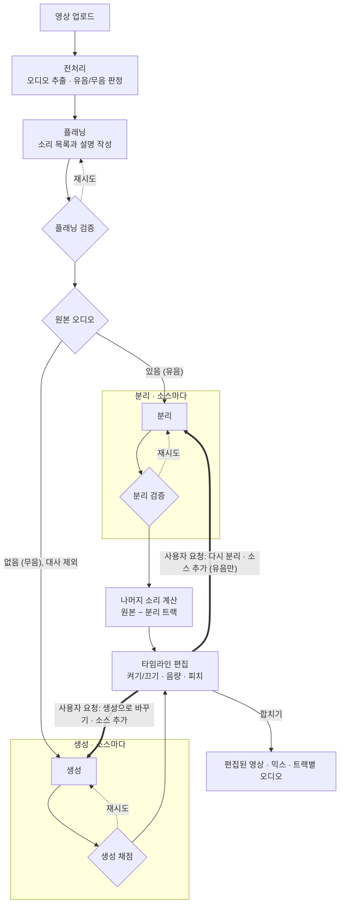
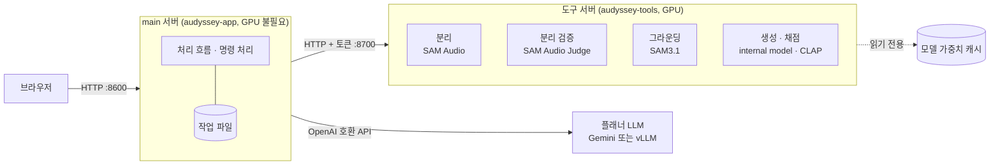

# Audyssey

Audyssey는 짧은 영상(10초 안팎)의 오디오를 소리를 내는 대상별 트랙(stem)으로 나누고, 필요한 소리를 생성해 다시 합치는 오디오 편집 도구입니다.

- 원본 오디오가 있는 영상은 먼저 분리합니다. 분리 결과가 만족스럽지 않은 소리나 원본에 없는 소리는 사용자가 요청하면 생성 모델로 만듭니다.
- 원본 오디오가 없는 영상은 대사를 제외한 소리를 자동으로 생성합니다.
- 트랙별로 켜고 끄거나 음량과 피치를 바꾼 뒤 합쳐, 편집된 영상과 트랙별 오디오를 내보냅니다.

현재는 실제 모델로 전체 흐름이 동작하는 것을 확인한 단계이며, 품질 개선은 모듈 담당자별로 진행합니다.

## 빠른 실행 (GPU 없이)

```bash
uv sync --extra ui
uv run audyssey serve
# 브라우저에서 http://127.0.0.1:8600 을 열고 samples/sample.mp4를 업로드합니다.
```

모든 모델 자리에 가짜 구현(stub)이 들어 있어 GPU, API 키, 모델 가중치 없이 동작합니다. Python 3.11 이상, [uv](https://docs.astral.sh/uv/), ffmpeg가 필요합니다.

## 처리 흐름



- 유음 영상은 분리를 기본으로 하고, 생성은 사용자가 요청할 때만 실행합니다. 분리 트랙을 생성으로 바꾸면 원래 트랙은 꺼진 채로 남아 다시 켤 수 있습니다.
- 무음 영상은 생성만 지원합니다. 대사는 생성하지 않습니다.
- 나머지 소리(residual)는 원본에서 분리 트랙만 빼서 계산합니다. 생성 트랙은 원본에서 나온 소리가 아니므로 계산에 포함하지 않습니다.
- 처리 순서는 코드에 고정되어 있습니다(LangGraph). 업로드하면 타임라인까지 자동으로 진행하고, 이후 편집은 사용자가 명령을 보내 실행합니다.

## 서버 구성



- main 서버는 GPU를 사용하지 않으며, 모델은 도구 서버와 플래너 LLM을 API로 호출합니다.
- 도구 서버 이미지 하나에 GPU 도구 네 가지가 모두 들어 있습니다. Compose에서는 도구별 컨테이너로, RunPod에서는 컨테이너 하나로 실행합니다.
- 각 도구는 `stub`(가짜), `real`(직접 실행), `remote`(다른 서버 호출) 중에서 고를 수 있어, 담당 모듈만 실제 모델로 실행하고 나머지는 stub으로 둘 수 있습니다.
- 그라운딩(시각 힌트)은 기본으로 꺼져 있습니다.

용어, 검증 규칙, 함수 시그니처, API는 [docs/architecture.md](docs/architecture.md)에 정리되어 있습니다.

## 실행 방법

기능 수정과 실험은 stub으로 진행하고, GPU는 실제 모델 통합 테스트를 할 때만 빌려 사용한 뒤 바로 반납합니다. stub은 업로드부터 합치기까지 전체 흐름을 1초 안에 실행하므로, 그래프, API, UI, 편집처럼 모델 품질과 관계없는 수정은 stub과 단위 테스트로 확인할 수 있습니다.

| 목적 | 필요한 것 | 안내 |
|---|---|---|
| GPU 없이 흐름 확인 | Python 3.11 이상, uv, ffmpeg | [빠른 실행](#빠른-실행-gpu-없이) |
| 실제 모델로 전체 실행 (처음 실행할 때) | Hugging Face 승인, 팀 조직 가입, 읽기 토큰 | [실제 모델로 실행하기](docs/running.md#실제-모델로-실행하기-팀원용) |
| 개인 GPU 서버에서 실행 | Docker, NVIDIA Container Toolkit, GPU 1장(80GB면 한 장으로 충분) | [A. 내 GPU 서버](docs/running.md#a-내-gpu-서버에서-docker-compose) |
| 노트북과 RunPod로 실행 | 노트북 Docker, RunPod Pod 1개(48GB 이상), 네트워크 볼륨 | [B. 노트북 + RunPod](docs/running.md#b-노트북--runpod) |
| 담당 모듈만 GPU로 개발 | GPU, `gpu/` 환경 | [모듈 개발](docs/running.md#내-모듈만-gpu로-개발) |
| 플래너 연결 | Gemini API 키 또는 vLLM 주소 | [플래너 연결](docs/running.md#플래너-연결-gemini-vllm) |
| 실행 기록 확인 | LangSmith 키 | [LangSmith](docs/running.md#langsmith) |

문제가 생기면 [자주 막히는 곳](docs/running.md#자주-막히는-곳)을, 설정 값은 [설정 표](docs/running.md#설정-환경변수)를 참고합니다.

## 작업 규칙

- 담당 모듈 폴더만 수정합니다. `src/audyssey/tools/<모듈>/real.py`를 같은 함수 시그니처로 구현하면 나머지 코드는 그대로 동작합니다.
- 공통 계약(`contracts.py`)을 바꿀 때는 PR에서 먼저 팀 합의를 받습니다.
- main에는 PR로만 반영합니다. CI(ruff, ty, 테스트)를 통과해야 머지할 수 있으며, 머지하면 Docker 이미지가 GHCR에 자동으로 게시됩니다.
- 테스트를 먼저 작성하고, 검사를 우회하지 않습니다(`noqa`, `ty: ignore`, skip 사용 금지).
- `.env`, 토큰, 모델 가중치는 커밋하지 않습니다.

브랜치와 커밋 형식, CI/CD 단계, 로컬 검사 명령은 [docs/contributing.md](docs/contributing.md)를 참고합니다.

## 모듈별 담당

| 모듈 | 위치 | 담당 | 할 일 |
|---|---|---|---|
| 오케스트레이터·API | `graph.py`, `api.py`, `store.py` | 오케스트레이터 담당 | 소스별 병렬 처리, 자연어 명령 해석 |
| UI | `devui/` (임시) | UI 담당 | API 기반 최종 화면 설계와 구현 |
| 플래닝 | `tools/planning/real.py` | 플래닝 담당 | `plan`·`validate_plan` 개선, 모델 선택, 오디오 정보 반영 |
| 분리 | `tools/separation/real.py` | 분리 담당 | 재시도 시 조건과 후보 수를 바꾸는 전략 |
| 분리 검증 | `tools/filtering/real.py` | 필터링 담당 | 합격 기준 보정, 실패 이유와 수정 제안 생성 |
| 그라운딩 | `tools/grounding/real.py` | 미정 | 위치 확인 강화, 추적 실패 대응 |
| 생성·채점 | `tools/generation/real.py` | 미정 | 생성 품질 확인, 채점 기준 보정 |
| 편집·합치기 | `tools/editing/render.py` | 미정 | 편집 품질 개선, 편집 명령 추가 |
| 인프라·배포 | `docker/`, `compose.yaml`, `.github/workflows/` | 인프라 담당 | RunPod 구성 검증, 가중치 준비 안내 |

모듈별 남은 과제와 실측 기록은 [docs/status.md](docs/status.md)에 있습니다.

## 문서

| 문서 | 내용 |
|---|---|
| [docs/architecture.md](docs/architecture.md) | 서버 구성, 용어, 검증과 재시도, 계약·함수·명령·API, 코드 위치 |
| [docs/running.md](docs/running.md) | 실행 방법, 플래너 연결, LangSmith, 가중치 준비, 설정 |
| [docs/contributing.md](docs/contributing.md) | 코드 규칙, 브랜치와 커밋, CI/CD, 로컬 검사 |
| [docs/status.md](docs/status.md) | 모듈별 남은 과제, 실측 기록 |
| [설계 문서](docs/superpowers/specs/) | 단계별 설계와 결정 기록 |
