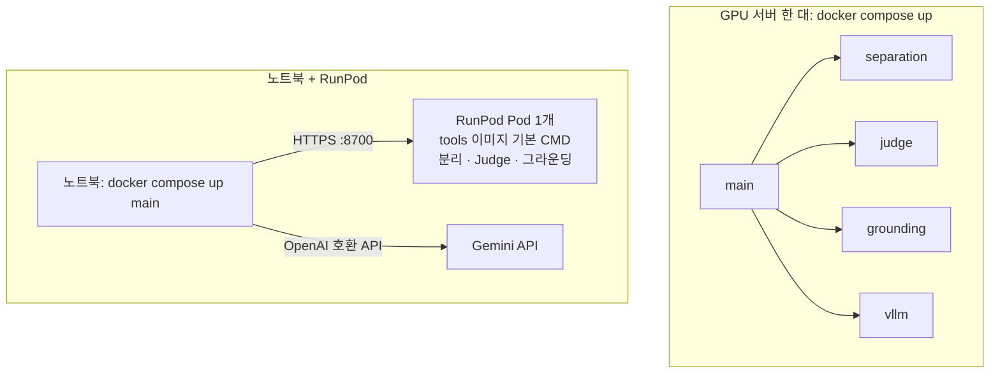

# 구조 상세

[README](../README.md)의 처리 흐름과 서버 구성 그림을 보충하는 문서입니다. 설계 원문은
[docs/superpowers/specs/2026-11-09-audyssey-skeleton-design.md](superpowers/specs/2026-11-09-audyssey-skeleton-design.md)에 있습니다.

## 서버 구성

| 구성 | 하는 일 | 실행 환경 |
|---|---|---|
| main 서버 | 흐름 실행, 명령 처리, 작업 저장, 개발용 화면. GPU를 쓰지 않음 | `audyssey-app` 이미지 (Python 3.13) |
| 도구 서버 | SAM Audio(분리), Judge(평가), SAM3(위치 찾기)를 HTTP로 제공 | `audyssey-tools` 이미지 (CUDA 12.8, Python 3.12) |
| 플래너 LLM | 소스 계획과 계획 검증. 주소만 바꾸면 Gemini와 vLLM을 오갈 수 있음 | Gemini API 또는 vLLM 서버 |

도구마다 실행 방식을 고릅니다.

- `stub`: 가짜 결과. GPU 없이 흐름을 확인할 때
- `real`: 같은 프로세스에서 모델 실행
- `remote`: 다른 서버에 띄운 도구 서버를 HTTP로 호출

배포 방식은 두 가지입니다. Compose는 도구마다 컨테이너를 띄우고, RunPod는 Pod 1개에서 도구 3개를 함께 띄웁니다.



## 용어

| 용어 | 뜻 |
|---|---|
| 소스 | 소리 나는 대상 1개. 같은 대상이 소리를 3번 내면 소스 1개에 구간 3개입니다. 종류가 같아도 대상이 다르면 다른 소스입니다 |
| 분리 조건 | 텍스트 설명(필수), 구간(선택), 시각 힌트(선택: 시점, 0~1 박스, 설명) |
| 시각 힌트 | 플래너가 화면에 보이는 소스마다 만듭니다. **기본값은 사용 안 함**(`AUDYSSEY_VISUAL_PROMPT=false`). 켜면 SAM3가 대상을 찾아 나머지를 검게 칠한 영상을 만들고, 분리할 때 함께 넣습니다 |
| 분리 트랙 | 소스마다 1개. 원본과 길이가 같은 48kHz 모노 WAV |
| 나머지 (residual) | 원본에서 모든 소스 트랙을 뺀 소리. 편집 없이 합치면 원본과 같습니다. `source_id="residual"`로 켜고 끄거나 음량을 바꿀 수 있습니다 |

## 검증과 재시도

| | 플래닝 검증 | 필터링 검증 |
|---|---|---|
| 검사 | 형식 검사 → `validate_plan` → (시각 힌트를 켰을 때) 힌트마다 SAM3 `locate` | `judge`가 분리 트랙을 평가 |
| 실패하면 | 문제 목록(`PlanIssue`)을 `plan(feedback=…)`에 넘겨 계획 전체를 다시 세움 | `suggestion`이 있으면 그 조건으로, 없으면 `attempt`를 1 올려 그 소스만 다시 분리 |
| 횟수 한도 | `AUDYSSEY_MAX_PLAN_ROUNDS=2` | `AUDYSSEY_MAX_SEPARATION_RETRIES=2` (최대 3번 시도) |
| 한도에 닿으면 | 마지막 계획으로 진행하고 경고 표시 | 마지막 트랙을 쓰고 `filter.passed=False` 경고 표시 |

## 계약, 함수, 명령, API

**공통 데이터 형식**은 [`src/audyssey/contracts.py`](../src/audyssey/contracts.py)에 Pydantic 모델로 있습니다.
주요 모델은 `SourcePlan`, `VisualHint`, `PlanIssue`, `FilterResult`, `GroundResult`, `Job`, `Command`입니다.
오디오는 파일 경로로 주고받고, 시간은 초 단위 float입니다.

**도구 함수**는 `stub`, `real`, `remote` 모두 시그니처가 같습니다.

```python
plan(video_path, audio_path, duration, feedback: list[PlanIssue]) -> list[SourcePlan]
validate_plan(video_path, audio_path, plans: list[SourcePlan]) -> list[PlanIssue]  # 빈 목록 = 통과
separate(mono_path, plan: SourcePlan, masked_video_path | None, out_path, attempt: int) -> out_path  # None = 텍스트만
judge(mono_path, track_path, plan: SourcePlan) -> FilterResult
locate(video: Path, hint: VisualHint) -> GroundResult
mask_video(video: Path, hint: VisualHint, out: Path) -> Path
render(job: Job, job_dir, include_residual_stem: bool) -> RenderOutput
```

**명령.** 작업 상태는 명령으로만 바꿉니다(`graph.handle_command`).
버튼, 나중에 붙일 자연어 입력, 에이전트가 모두 같은 명령을 쓰게 하려는 규칙입니다.

```
keep / drop(source_id)            set_gain(source_id, 0.0~2.0)     set_pitch(source_id, -12~+12)
reseparate(source_id, description?, spans?)   add_source(plan)     render(include_residual_stem)
```

**main 서버 API.** UI는 아래 API만 쓰면 됩니다.

```
POST /api/jobs                    multipart(video) → Job (업로드 후 자동 진행)
GET  /api/jobs                    → Job 요약 목록
GET  /api/jobs/{id}               → Job
GET  /api/jobs/{id}/events        SSE: 상태가 바뀔 때마다 Job 전송
POST /api/jobs/{id}/commands      Command → Job | 409(실행 중) | 422(형식 오류)
GET  /api/jobs/{id}/files/{path}  작업 폴더의 오디오·영상·파형 파일
```

**도구 서버 API.** `/health`를 빼면 모두 `Authorization: Bearer $AUDYSSEY_TOOL_TOKEN`이 필요합니다.

```
GET  /health                                    인증 없음
POST /separate  multipart mono, plan, attempt (+ video)     → WAV   video는 시각 힌트를 켰을 때만
POST /judge     multipart mono, track, plan                  → FilterResult
POST /locate    multipart video, hint                        → GroundResult
POST /mask      multipart video, hint                        → MP4
```

## 코드 위치

```
src/audyssey/
  contracts.py   팀 공통 계약 (변경은 PR로 합의)
  settings.py    AUDYSSEY_* 환경변수 (pydantic-settings)
  graph.py       LangGraph 흐름, 검증 루프, 명령 처리
  store.py       Job ↔ work/jobs/<id>/job.json
  api.py         HTTP API + 개발용 화면
  toolserver.py  도구 서버
  cli.py         audyssey serve | audyssey tool-server
  media.py       ffmpeg 추출·프레임·WAV 입출력
  devui/         빌드 없는 개발용 화면 (최종 UI 아님)
  tools/
    planning/    stub.py real.py llm.py      plan, validate_plan
    separation/  stub.py real.py remote.py   separate (SAM Audio)
    filtering/   stub.py real.py remote.py   judge (SAM Audio Judge)
    grounding/   stub.py real.py remote.py   locate, mask_video (SAM3)
    editing/     render.py                   residual, pitch, render
gpu/             GPU 도구 전용 uv 프로젝트 (Python 3.12, numpy 1.26, torch cu128)
docker/          app.Dockerfile, tools.Dockerfile
compose.yaml     main + separation + judge + grounding + vllm
tests/           unittest (GPU 코드는 가짜 torch/sam_audio로 검사)
```
